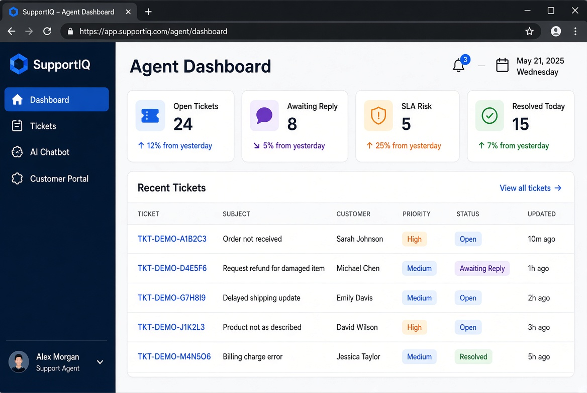
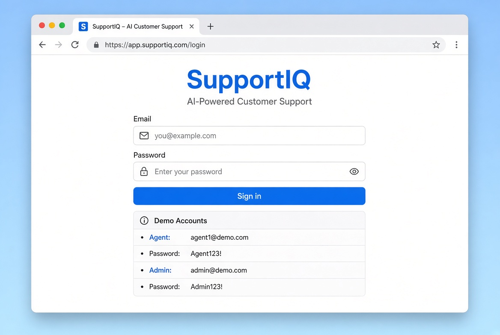
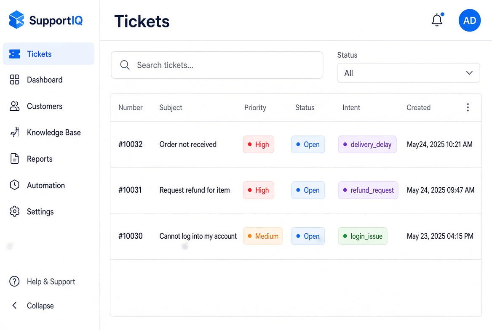

# SupportIQ – AI-Powered Customer Support Intelligence Platform


**SupportIQ** is a full-stack, production-style customer support platform that combines traditional ticket management with modern AI capabilities — intelligent classification, Retrieval-Augmented Generation (RAG) chatbot, agent assist, multi-tenancy, and SLA awareness.

Built by a full-stack Python developer to solve real operational pain in modern support teams.

---

## Why I Created This Project

Customer support teams face three recurring problems:

1. **High volume of repetitive tickets** – Agents spend too much time classifying, prioritizing, and answering the same questions.
2. **Knowledge is scattered** – Policies, FAQs, and product information live in PDFs, Notion pages, and old tickets. Finding the right answer is slow and inconsistent.
3. **Most AI support demos don’t survive real use** – They break on multi-tenancy, permissions, unsafe answers, or lack of human oversight.

I built **SupportIQ** to demonstrate how a real engineering team should approach an AI-assisted support system:

- Strict multi-tenant data isolation
- Human-in-the-loop AI (suggestions never auto-send)
- Provider-independent LLM layer (works offline with mocks)
- Safe RAG with citations and prompt-injection protection
- Clean modular architecture that can grow into a real product

This repository is both a **portfolio project** and a **practical foundation** that others can extend.

---

## What Problem Does It Solve?

| Problem | How SupportIQ Helps |
|---------|---------------------|
| Manual ticket triage is slow | AI automatically classifies intent, category, and urgency |
| Agents rewrite the same replies | AI suggests context-aware replies that agents can edit and approve |
| Customers wait for simple answers | RAG chatbot answers from approved knowledge base with source citations |
| Knowledge base is hard to search | Semantic search over documents and articles |
| No visibility into AI quality | Feedback, corrections, and evaluation hooks are built in |
| Risk of data leakage across customers | Strict organization-level isolation on every query |
| Vendor lock-in to one LLM provider | Abstract provider layer (Mock / OpenAI-compatible) |

---

## Screenshots

### 1. Login Page
Clean authentication screen with demo credentials for quick exploration.



### 2. Agent Dashboard
Overview of open tickets, workload indicators, and recent activity.



### 3. Ticket List
Searchable, filterable ticket table showing priority, status, and AI-detected intent.


### 4. Ticket Detail + AI Assist
Full ticket view with AI classification confidence and suggested-reply actions.



---

## Full Workflow

```
Customer / Agent
       │
       ▼
┌──────────────────┐
│  React Frontend  │  ← Login • Dashboard • Tickets • Chatbot
└────────┬─────────┘
         │ JWT
         ▼
┌──────────────────┐
│  FastAPI Backend │  ← Auth • RBAC • Ticket APIs • Chatbot API
└────────┬─────────┘
         │
    ┌────┴────┬──────────────┬──────────────┐
    ▼         ▼              ▼              ▼
PostgreSQL  Redis        Celery         AI Engine
+ pgvector  (cache /     Workers        (Classify,
            broker)                     RAG, Suggest)
    │
    ▼
Knowledge Base (Articles + Document Chunks + Embeddings)
```

### Typical User Flows

1. **Customer creates a ticket** → AI classifies intent / category / sentiment → Agent is notified.
2. **Customer uses the chatbot** → Query is embedded → Relevant chunks retrieved (tenant-scoped) → LLM generates a grounded answer with citations → Escalates if confidence is low.
3. **Agent opens a ticket** → Sees AI classification + suggested reply → Edits / approves → Reply is sent.
4. **Admin uploads a policy document** → Background job extracts text, chunks it, generates embeddings, and indexes it for RAG.

---

## Tech Stack

| Layer              | Technology                                      |
|--------------------|--------------------------------------------------|
| Backend            | Python 3.12, FastAPI, Pydantic v2, SQLAlchemy 2 |
| Authentication     | JWT + Refresh Tokens, Passlib / Bcrypt, RBAC     |
| Primary Database   | PostgreSQL 16 + pgvector                         |
| Flexible Storage   | MongoDB (webhook / event payloads)               |
| Cache & Broker     | Redis                                            |
| Background Jobs    | Celery + Celery Beat                             |
| AI / LLM           | OpenAI-compatible API + Mock provider            |
| Embeddings         | Mock (deterministic) / OpenAI embeddings         |
| Frontend           | React 18, TypeScript, Vite, Tailwind CSS         |
| State Management   | Zustand + TanStack Query                         |
| Containerization   | Docker, Docker Compose, Nginx                    |
| Testing            | Pytest                                           |

---

## How to Execute the Project

### Option A – Docker (Recommended)

```bash
git clone <your-repo-url>
cd supportiq

cp .env.example .env          # defaults work for local demo

docker compose up -d --build

# Seed demo data (after Postgres is healthy)
docker compose exec backend python /app/../scripts/seed_demo.py
```

| Service   | URL                          |
|-----------|------------------------------|
| Frontend  | http://localhost:5173        |
| API Docs  | http://localhost:8000/docs   |
| Health    | http://localhost:8000/health |

### Option B – Local Development

```bash
# Backend
cd backend
python -m venv .venv
source .venv/bin/activate          # Windows: .venv\Scripts\activate
pip install -r requirements.txt
export PYTHONPATH=.
uvicorn app.main:app --reload --port 8000

# Seed data (new terminal)
cd backend
PYTHONPATH=. python ../scripts/seed_demo.py

# Frontend (new terminal)
cd frontend
npm install
npm run dev
```

### Demo Credentials

| Role     | Email                | Password      |
|----------|----------------------|---------------|
| Admin    | admin@demo.com       | Admin123!     |
| Manager  | manager@demo.com     | Manager123!   |
| Agent    | agent1@demo.com      | Agent123!     |
| Customer | customer@demo.com    | Customer123!  |

---

## Project Structure

```
supportiq/
├── backend/
│   ├── app/                  # FastAPI application
│   │   ├── api/v1/           # REST endpoints
│   │   ├── core/             # Security & dependencies
│   │   ├── models/           # SQLAlchemy models
│   │   ├── schemas/          # Pydantic schemas
│   │   ├── services/         # Business logic
│   │   └── main.py
│   ├── ai_engine/            # LLM, RAG, classification, guardrails
│   ├── workers/              # Celery tasks
│   ├── tests/
│   └── requirements.txt
├── frontend/                 # React + TypeScript SPA
├── scripts/seed_demo.py
├── docs/
│   └── screenshots/          # UI screenshots used in this README
├── infrastructure/
├── docker-compose.yml
├── .env.example
└── README.md
```

---

## Challenges I Faced & How I Solved Them

| Challenge | Solution | Why This Approach |
|-----------|----------|-------------------|
| LLM calls scattered everywhere | Built clean `LLMProvider` / `EmbeddingProvider` abstractions + factory | Easy to swap providers and run fully offline |
| AI inventing refunds or actions | `SafetyGuard` + strict system prompts + post-generation checks | Prevents dangerous hallucinations in production |
| Multi-tenant data leakage risk | Every query filters by `organization_id`; enforced in dependencies | Non-negotiable for any real SaaS product |
| pgvector not always available in dev | Graceful fallback in RAG pipeline + deterministic mock embeddings | Project remains runnable without a full vector DB |
| Heavy AI work blocking the API | Designed Celery tasks for classification & document processing | Keeps the API responsive under load |
| Agents losing control of AI | Suggestions require explicit accept / edit / reject | Human-in-the-loop builds trust and safety |
| Complex frontend ↔ backend auth | JWT + refresh rotation + Zustand persist + Axios interceptors | Smooth UX while staying secure |

---

## Current Limitations

- The full document upload → extract → chunk → embed pipeline is modeled and has Celery task stubs, but the complete UI + worker flow is not fully wired in this version.
- Vector search requires a live PostgreSQL instance with the `pgvector` extension. Without it the chatbot safely returns “no relevant documents”.
- Power BI dashboards are prepared at the schema/SQL level; actual `.pbix` files are not included.
- Some advanced features (real-time WebSockets, full evaluation harness, hybrid search + reranking) are architected but not fully implemented.
- Default mode uses **Mock AI** so the project runs without paid API keys. Real answer quality depends on the configured LLM provider.

These limitations are intentional so the codebase stays focused, runnable, and easy to extend.

---

## What Results You Will See

After seeding data and logging in as an agent:

1. **Dashboard** shows open tickets and recent activity.
2. **Ticket list** displays AI-detected intents (`delivery_delay`, `refund_request`, `login_issue`, etc.).
3. Opening a ticket reveals classification confidence and AI-assist actions.
4. **Chatbot** answers policy questions using the seeded knowledge base (refund policy, shipping FAQ, account recovery, etc.) and surfaces citations when available.
5. All data is scoped to the demo organization — no cross-tenant leakage.

---

## Future Improvements

- Complete document ingestion pipeline with progress UI
- Real-time updates via WebSockets
- Full agent performance & AI quality analytics dashboards
- Evaluation dataset + regression suite for prompts and models
- Production deployment guides (AWS / GCP / Azure)

---

## Author

Full-stack Python developer focused on building practical, production-minded AI systems.

Feel free to fork, open issues, or use this as a foundation for your own support platform.

---

## License

MIT
